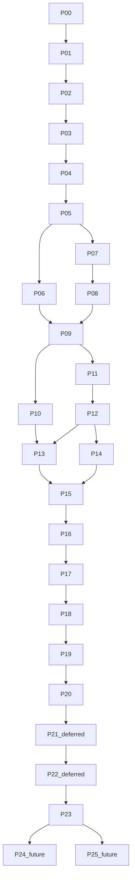

# AI Sales Agent Platform — Plan Index

> Start every task with: **"Apply docs/GLOBAL_RULES.md."** (also enforced automatically by `.cursor/rules/global-engineering-rules.mdc`).

Sources: chat brief (enterprise architecture requirements) + `AI_Sales_Agent_Final_Plan_v1_5.pdf` (product scope MVP v1.5). Comparison and coverage: `architecture/21_requirements_traceability.md`.

## How to execute
1. Open the next phase file in `phases/` (strict order below).
2. Paste its **Prompt header** into your implementation request.
3. Implement the phase as a vertical slice (backend + API + web + settings + tests).
4. Check **Acceptance criteria** and **Rules checklist**.
5. Log it in `PROGRESS_LOG.md` (and `CHANGELOG.md`, ADRs if any). Then move to the next phase.

## Phase order
| # | Phase | Depends on | Status |
|---|---|---|---|
| 00 | [Workspace foundation](phases/phase_00_workspace_foundation.md) | — | ☑ |
| 01 | [Backend core platform](phases/phase_01_backend_core_platform.md) | 00 | ☐ |
| 02 | [Database & multi-tenancy](phases/phase_02_database_multitenancy.md) | 01 | ☐ |
| 03 | [Auth, workspace & RBAC](phases/phase_03_auth_workspace_rbac.md) | 02 | ☑ |
| 04 | [Frontend foundation](phases/phase_04_frontend_foundation.md) | 03 | ☑ |
| 05 | [Plans, subscription, payment, admin](phases/phase_05_plans_subscription_payment_admin.md) | 03, 04 | ☐ |
| 06 | [Catalogue, CSV & FAQ](phases/phase_06_catalogue_csv_faq.md) | 05 | ☐ |
| 07 | [AI platform core](phases/phase_07_ai_platform_core.md) | 02, 05 | ☐ |
| 08 | [Usage ledger & quotas](phases/phase_08_usage_ledger_quotas.md) | 05, 07 | ☐ |
| 09 | [Conversation core & sandbox](phases/phase_09_conversation_core.md) | 06, 08 | ☐ |
| 10 | [Messenger channel](phases/phase_10_messenger_channel.md) | 09 | ☐ |
| 11 | [Guard & seller rules](phases/phase_11_conversation_guard_seller_rules.md) | 09 | ☐ |
| 12 | [Answering engine & safety](phases/phase_12_answering_engine.md) | 07, 08, 11 | ☐ |
| 13 | [Voice / STT pipeline](phases/phase_13_voice_stt_pipeline.md) | 10, 12 | ☐ |
| 14 | [Orders & confirmation](phases/phase_14_orders_confirmation.md) | 12 | ☐ |
| 15 | [Seller panel & settings centre](phases/phase_15_seller_panel.md) | 13, 14 | ☐ |
| 16 | [Learning queue & RAG](phases/phase_16_learning_queue_knowledge_rag.md) | 15 | ☐ |
| 17 | [Analytics & export](phases/phase_17_analytics_metrics.md) | 16 | ☐ |
| 18 | [Observability hardening](phases/phase_18_observability_hardening.md) | 17 | ☐ |
| 19 | [Security, privacy, compliance](phases/phase_19_security_privacy_compliance.md) | 18 | ☐ |
| 20 | [Testing & quality gates](phases/phase_20_testing_quality_gates.md) | 19 | ☐ |
| 21 | [Containerization](phases/phase_21_containerization.md) — **DEFERRED** | 20 | ☐ |
| 22 | [CI/CD](phases/phase_22_cicd_pipeline.md) — **DEFERRED** | 21 | ☐ |
| 23 | [Deployment & production readiness](phases/phase_23_deployment_production_readiness.md) | 22 | ☐ |
| 24 | [Mobile app](phases/phase_24_mobile_app.md) — **FUTURE** | 23 | ☐ |
| 25 | [Future extensions](phases/phase_25_future_extensions.md) — **FUTURE** | 23 | ☐ |

Phase 10 (Messenger) can run in parallel with 11–12 because the sandbox channel (09) lets the pipeline be built without Meta approval.

## Architecture reference
| Doc | Topic |
|---|---|
| [01](architecture/01_system_architecture.md) | System architecture |
| [02](architecture/02_technology_stack.md) | Technology stack |
| [03](architecture/03_frontend_architecture.md) | Frontend |
| [04](architecture/04_backend_architecture.md) | Backend |
| [05](architecture/05_database_architecture.md) | Database |
| [06](architecture/06_authentication_authorization.md) | AuthN / AuthZ |
| [07](architecture/07_ai_llm_platform.md) | AI / LLM platform |
| [08](architecture/08_rag_architecture.md) | RAG |
| [09](architecture/09_event_driven_architecture.md) | Events |
| [10](architecture/10_background_processing.md) | Background jobs |
| [11](architecture/11_caching_strategy.md) | Caching |
| [12](architecture/12_monitoring_observability.md) | Observability |
| [13](architecture/13_security_architecture.md) | Security |
| [14](architecture/14_testing_strategy.md) | Testing |
| [15](architecture/15_cicd_strategy.md) | CI/CD (deferred) |
| [16](architecture/16_docker_deployment_strategy.md) | Docker & deployment (deferred) |
| [17](architecture/17_production_readiness_checklist.md) | Production checklist |
| [18](architecture/18_folder_structures.md) | Folder structures |
| [19](architecture/19_api_design_standards.md) | API standards |
| [20](architecture/20_domain_model_and_state_machines.md) | Domain model & state machines |
| [21](architecture/21_requirements_traceability.md) | Requirements traceability |
| [22](architecture/22_error_logging_and_history.md) | Error logging & history |
| [23](architecture/23_multi_client_mobile_readiness.md) | Mobile readiness |
| [24](architecture/24_configuration_management.md) | Configuration (who configures what) |

## Other files
- [GLOBAL_RULES.md](GLOBAL_RULES.md) — mandatory rules
- [PROGRESS_LOG.md](PROGRESS_LOG.md) — implementation history per phase
- [CHANGELOG.md](CHANGELOG.md) — user-visible changes
- [adr/](adr/) — architecture decision records
