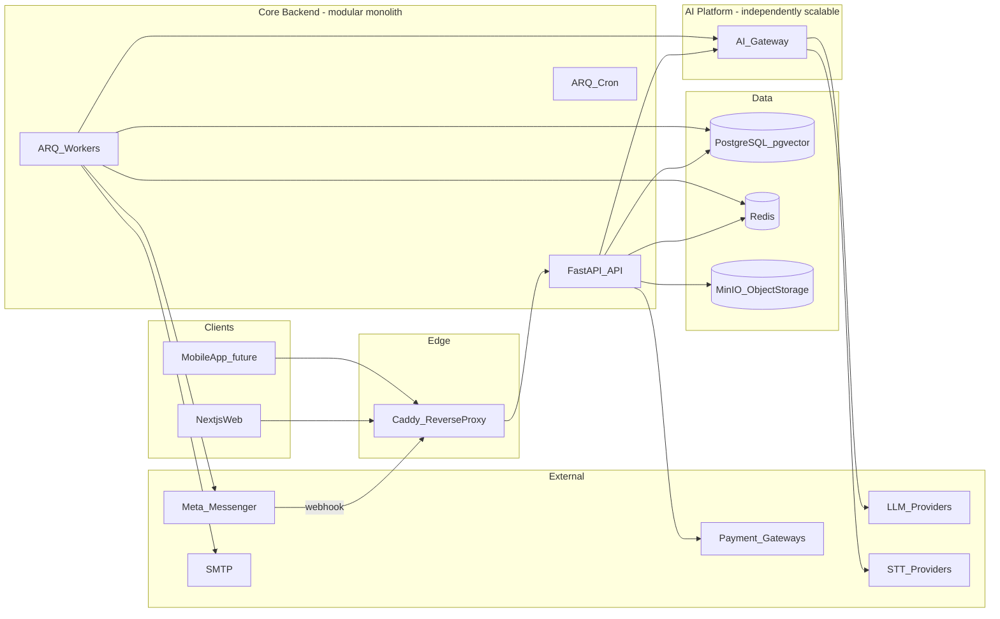
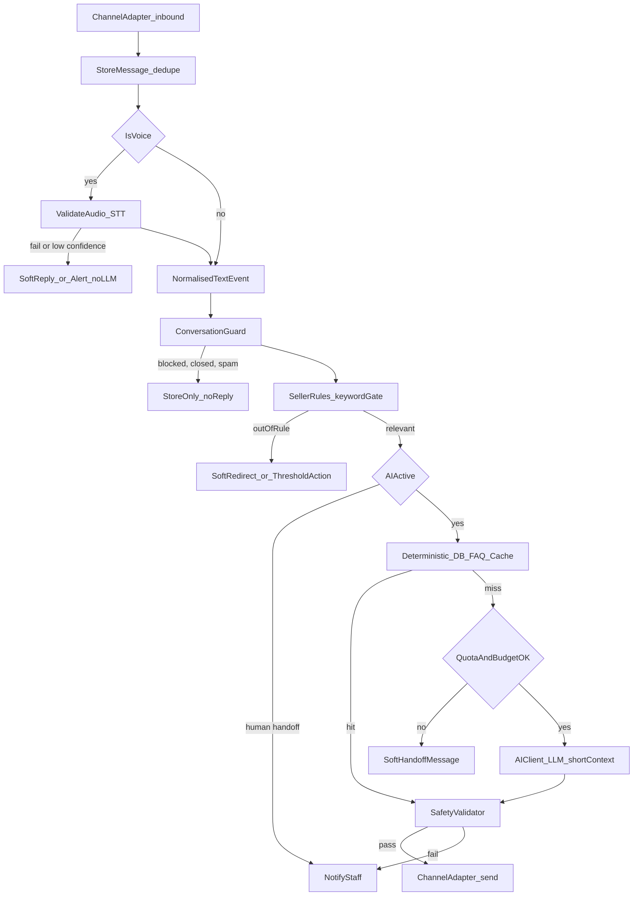

# 01 — System Architecture

> Apply `docs/GLOBAL_RULES.md`.

## 1. Product context

**AI Sales Agent Platform** — multi-tenant SaaS for Bangladesh F-commerce / SME sellers. Sellers connect their Facebook Messenger inbox (Instagram/WhatsApp later), load products (manual / CSV), define allowed topics, and an AI agent replies to customers (text + voice) in the seller's style, with human control, cost control and abuse protection.

**Key product rule:** public discovery is open; subscription activation requires admin approval + verified payment.

## 2. Architectural style

| Decision | Choice | Why |
|---|---|---|
| Deployment shape | **Modular monolith** (one backend deployable + workers) + **independently deployable AI platform** | Fast to build, cheap to run, one DB transaction boundary; modules extractable later |
| Module internals | **Hexagonal (ports & adapters)** + light DDD (aggregates, value objects, domain events) | Testability, provider swap, microservice readiness |
| Integration between modules | In-process application interfaces + **domain events via transactional outbox** | Loose coupling, future broker swap |
| Data | PostgreSQL (single cluster, schema-per-module ownership, RLS for tenants) + pgvector | One reliable OSS store; vectors without new infra |
| Async | Redis + ARQ workers; Redis Streams event bus | Lightweight, OSS, async-native |
| Clients | API-first; Next.js web now; mobile (Expo) later | One contract for all clients |

## 3. High-level component diagram

## 4. Backend modules (bounded contexts)

| Module | Responsibility |
|---|---|
| `identity` | Users, credentials, sessions, tokens, devices |
| `tenancy` | Businesses (tenants), memberships, team roles, onboarding state |
| `settings` | Settings registry, layered resolver, message templates, secrets store |
| `billing` | Plans, entitlements, subscriptions, payments, invoices, top-ups |
| `catalogue` | Products, variants, categories, CSV import, images |
| `faq` | Seller FAQ entries |
| `customers` | Buyer profiles per channel identity |
| `channels` | Channel adapters (Messenger, sandbox simulator, future IG/WA), page connections, outbound send |
| `conversations` | Conversations, messages, lifecycle + handoff state machines, transcripts |
| `guard_rules` | Conversation Guard (rate/spam) + Seller Conversation Rules (keyword gate) |
| `agent_settings` | Persona/style, AI mode, handoff triggers |
| `answering` | Token-efficient answering engine, safety validator |
| `orders` | Order capture, confirmation, statuses |
| `learning` | Staff-reply learning queue, redaction, approval, versioned knowledge |
| `usage` | UsageLedger, quotas, fair-use, budget caps |
| `analytics` | Read models, dashboards, exports |
| `admin` | Platform admin console use cases, impersonation |
| `audit` | Append-only audit log, error events |
| `notifications` | In-app, email, (future push/SMS) notifications |
| `public` | Public site read APIs (plans, feature matrix, public catalogue) |

`ai-platform` (separate package/service): providers (LLM/STT/embeddings), prompt registry, AI usage + cost tracking, AI response cache, RAG retrieval, gateway API, client SDK.

## 5. Core message pipeline

Each step is a pipeline stage behind an interface (`PipelineStage`) so stages can be added (e.g. image recognition) without changing others.

## 6. Quality attribute strategies

| Attribute | Strategy |
|---|---|
| Scalability | Stateless API (horizontal), separate worker pools per queue (stt, ai, send, import), AI gateway scaled independently, PG read replica + PgBouncer later, partition large tables (messages, usage, audit) by month |
| Maintainability | Module boundaries enforced by import-linter, uniform module template, ADRs |
| Modularity / extensibility | Ports & adapters, pipeline stages, channel adapter interface, settings registry, event-driven hooks |
| Reusability | `ai_platform` as standalone package; shared kernel; frontend shared packages |
| Testability | Fakes for every port, in-memory module tests, contract tests |
| Security | Deny-by-default, RLS, signed webhooks, encrypted secrets, audit |
| Cost efficiency | Deterministic-first engine, caching, cheap-model routing, budgets, single VM start, OSS stack |
| Performance | Async I/O, Redis caching, background processing, indexes, pagination |
| Observability | OpenTelemetry traces/metrics/logs, trace_id everywhere, error_events |
| Future extensibility | Reserved hooks: `SyncConnection`, `SyncJob`, `external_id`, channel adapters, mobile app slot |

## 7. Microservice migration path

1. Module boundaries already enforce no shared tables / no internal imports.
2. Extract candidate (e.g. `channels` webhook ingress, `ai-platform`, `analytics`): replace in-process facade with HTTP/gRPC client adapter; move event consumption to broker.
3. Move module tables to its own database (data already owned by module).
4. Swap Redis Streams for NATS/Kafka if throughput requires (adapter change only).

First natural extractions: **AI platform** (already separate), **channel ingress** (webhook spikes), **analytics** (read-heavy).

## 8. Related documents
02 stack · 04 backend · 07 AI · 09 events · 18 folders · 20 domain model · 24 configuration.
