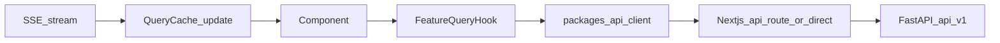

# 03 — Frontend Architecture

> Apply `docs/GLOBAL_RULES.md` (esp. R-FE-*, R-API-07, R-CFG-05).

## 1. Principles
- The web app is **one client of the API**; no business rules in the client (R-FE-01).
- Monorepo with shared, platform-neutral packages so a mobile app can be added later.
- Feature-sliced design; server state in TanStack Query; schema-driven settings forms.
- Bangla + English first-class (next-intl), accessible (WCAG 2.1 AA), responsive (seller panel used on phones).

## 2. Monorepo layout
```
frontend/
  apps/
    web/                     Next.js 15 App Router
    mobile/                  RESERVED (Phase 24, Expo)
  packages/
    api-client/              generated OpenAPI types + typed fetch client
    shared/                  Zod schemas, constants, error-code map, utils (no DOM)
    i18n/                    bn/en message catalogues (JSON), shared by web + mobile
    design-tokens/           colors, spacing, radius, typography (CSS vars + TS export)
```

## 3. Web app structure (`apps/web/src`)
```
app/
  (public)/                  landing, pricing + feature matrix, public catalogue, privacy, terms
  (auth)/                    login, register, forgot/reset password, verify email
  (seller)/                  seller panel (requires active membership)
    inbox/  conversations/[id]/  catalogue/  faq/  rules/  agent/  orders/
    customers/  learning/  usage/  analytics/  billing/  settings/  sandbox/  onboarding/
  (admin)/                   platform admin console (requires admin role)
    tenants/  subscriptions/  payments/  plans/  providers/  prompts/  settings/
    audit/  errors/  jobs/  content/
  api/                       ONLY thin BFF routes (auth cookie handling, SSE proxy) — no business logic
  layout.tsx, error.tsx, not-found.tsx
features/<feature>/
  components/  hooks/  api/ (query/mutation hooks over api-client)  schemas/  index.ts (public surface)
shared/
  ui/ (shadcn wrappers, layout, data-table, form fields, schema-form renderer)
  lib/ (auth session, sse client, formatters, error mapper)
  config/ (env, routes, query client)
  hooks/
```

Features: `auth, onboarding, settings, catalogue, faq, customers, conversations, rules, agent_settings, sandbox, orders, billing, usage, analytics, notifications, admin, platform_settings, learning`.

Rule: a feature may import `shared/*`, `packages/*`, and another feature **only via its `index.ts`**. Enforced with ESLint `boundaries` / `no-restricted-imports`.

## 4. Data flow


- **Auth (web):** login through Next.js route handler → backend; access + refresh tokens stored in **httpOnly, Secure, SameSite=Lax cookies**; Next.js middleware guards route groups; refresh is transparent. Mobile will use Bearer tokens directly.
- **Rendering:** Server Components for public pages (SEO, ISR for public catalogue/pricing); client components for interactive seller panel.
- **Realtime:** one SSE connection per session (`/api/v1/realtime/stream`); events update TanStack Query cache (new message, handoff, urgency, notification).
- **Errors:** route-group `error.tsx` boundaries; API errors mapped by `error.code` → i18n message; unexpected errors reported to GlitchTip with `trace_id`.

## 5. Schema-driven settings
`GET /api/v1/settings/schema?scope=tenant|user` returns setting definitions (JSON Schema + UI hints + edit permission + entitlement). `shared/ui/schema-form` renders forms; adding a backend setting requires no new UI code (R-FE-07).

## 6. State management
| State | Tool |
|---|---|
| Server data | TanStack Query (keys: `[tenantId, feature, ...]`) |
| Forms | react-hook-form + Zod (schemas in `packages/shared`) |
| URL state | search params (filters, pagination cursors) |
| Ephemeral UI | React state / small Zustand store only if needed |

## 7. Performance
Route-level code splitting, virtualized inbox list, optimistic updates for take-over/assign, image optimization, ISR for public pages, bundle budget checks.

## 8. Testing
Vitest + Testing Library (components/hooks), MSW for API mocks, Playwright e2e for critical flows (signup → subscription request, CSV import, rules, take-over, order confirm). See doc 14.

## 9. Mobile readiness
See doc 23. Packages must not import Next.js or DOM APIs.
