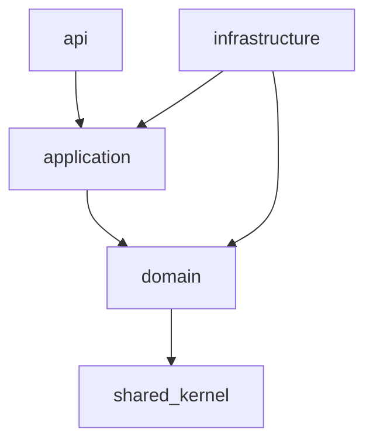

# 04 — Backend Architecture

> Apply `docs/GLOBAL_RULES.md` (esp. R-ARCH-*, R-TEN-*, R-OBS-*).

## 1. Layout
```
backend/
  src/app/
    main/            composition root: FastAPI app factory, DI container, router registration, worker settings
    core/            cross-cutting infrastructure: config, db (engine/session/tenant context), logging,
                     errors, security (jwt, hashing, crypto), cache, events (outbox, bus), jobs (queue),
                     storage, email, realtime, http client, clock, ids, observability
    shared/          shared kernel: base Entity/AggregateRoot, ValueObject, DomainEvent, Result, Money,
                     TenantContext, Pagination, typed error base classes
    modules/<module>/
      domain/        entities, value objects, domain services, domain events, repository PORTS
      application/   use cases (commands/queries), DTOs, module public facade (interface), ports for external needs
      infrastructure/ SQLAlchemy models + repositories, adapters, event handlers, job handlers
      api/           FastAPI routers, request/response schemas, dependencies (permission, entitlement)
    workers/         ARQ WorkerSettings per queue, cron schedule registration
  migrations/        Alembic (one env, module-tagged revisions)
  tests/{unit,integration,contract,e2e}
```

## 2. Layer rules

- `domain`: pure Python. No I/O, no framework.
- `application`: orchestrates use cases, owns transactions (Unit of Work), calls ports, emits events.
- `infrastructure`: implements ports (repos, adapters). Only layer touching SQLAlchemy/Redis/HTTP.
- `api`: HTTP mapping only; no business logic.
- Cross-module: `from app.modules.catalogue.application.facade import CatalogueFacade` ✔ — `from app.modules.catalogue.infrastructure...` ✘.

`import-linter` contracts: layers contract per module + independence contract between modules (only `application.facade` / `application.contracts` allowed).

## 3. Use case pattern
```python
class ImportProductsCsv(UseCase[ImportCsvCommand, ImportBatchDTO]):
    def __init__(self, uow: UnitOfWork, storage: ObjectStorage, settings: SettingsResolver,
                 audit: AuditPort, clock: Clock) -> None: ...

    async def execute(self, cmd: ImportCsvCommand, ctx: RequestContext) -> ImportBatchDTO:
        # validate → domain logic → persist → outbox event → audit
```
- Every use case receives a `RequestContext` (user_id, tenant_id, roles, trace_id, locale, client type).
- Commands mutate; queries read (light CQRS; read models allowed for analytics/inbox).

## 4. Cross-cutting core services (ports)
| Port | Default adapter |
|---|---|
| `UnitOfWork` / repositories | SQLAlchemy async |
| `EventBus` + `Outbox` | PG outbox table + relay worker → Redis Streams |
| `JobQueue` | ARQ |
| `Cache` | Redis |
| `ObjectStorage` | MinIO (S3) |
| `EmailSender` | SMTP (Mailpit dev) |
| `RealtimePublisher` | Redis pub/sub → SSE endpoint |
| `SettingsResolver`, `TemplateRenderer`, `SecretsStore` | `settings` module |
| `EntitlementChecker` | `billing` module facade |
| `AuditPort` | `audit` module |
| `AIClient` | `ai_platform.client` (in-process or HTTP) |
| `Clock`, `IdGenerator` | system clock, UUIDv7 |

## 5. Request lifecycle
1. Middleware: request_id/trace_id, structured log context, CORS, security headers, rate limit.
2. Auth dependency: cookie or Bearer → `Principal`.
3. Tenant dependency: resolve active tenant (header `X-Tenant-Id` / token claim) → verify membership → set `app.tenant_id` for RLS.
4. Permission + entitlement dependency per route.
5. Use case → UoW commit → outbox.
6. Exception handler → error envelope.

## 6. Error catalogue
`AppError(code, http_status, message_key, details)` subclasses: `ValidationError 422`, `NotFoundError 404`, `PermissionDeniedError 403`, `UnauthenticatedError 401`, `ConflictError 409`, `EntitlementRequiredError 402/403`, `QuotaExceededError 429`, `RateLimitedError 429`, `ExternalProviderError 502`, `DomainRuleViolation 422`. Codes like `catalogue.csv.invalid_header`, `billing.subscription.not_active`.

## 7. Module template (copy for every new module)
```
modules/<name>/
  __init__.py
  domain/{entities.py, value_objects.py, events.py, repositories.py, services.py, errors.py}
  application/{facade.py, commands.py, queries.py, dto.py, ports.py, use_cases/}
  infrastructure/{models.py, repositories.py, adapters/, handlers.py, jobs.py}
  api/{router.py, schemas.py, dependencies.py}
  settings.py      # settings registry declarations for this module
  templates.py     # message template keys + defaults for this module
  permissions.py   # permission constants
```

## 8. Workers & queues
Separate queues: `default`, `inbound` (pipeline), `stt`, `ai`, `outbound` (channel send), `import`, `notifications`, `maintenance` (cron). Each worker pool scaled independently. See doc 10.

## 9. Testing
Unit (domain/application with fakes) · integration (repos with real PG/Redis) · contract (adapters vs ports) · API e2e (httpx AsyncClient). See doc 14.
