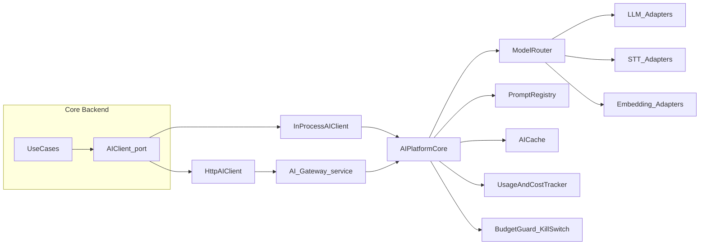

# 07 — AI / LLM Platform Architecture

> Apply `docs/GLOBAL_RULES.md` (esp. R-AI-*, R-CFG-*).

## 1. Goals
Reusable, provider-agnostic, maintainable, **independently scalable** AI layer supporting LLM chat, STT (voice), embeddings, prompt management, token + cost tracking, caching, budgets, routing/fallback, evaluation and RAG — with **zero provider knowledge in business code**.

## 2. Packaging & deployment modes
`ai-platform/` is a standalone Python package `ai_platform` (own `pyproject`, own tests) with two runtime modes:

| Mode | How | When |
|---|---|---|
| In-process | Backend imports `ai_platform` and uses `InProcessAIClient` | MVP, single VM |
| Remote gateway | `ai_platform.gateway` runs as its own FastAPI service; backend uses `HttpAIClient` | Scale/isolate AI independently, multiple products reuse it |

Switching modes = config change in the composition root. Both implement the same `AIClient` port.



## 3. Package layout
```
ai-platform/src/ai_platform/
  contracts/     AIClient protocol, request/response DTOs (ChatRequest, ChatResult, SttRequest, SttResult,
                 EmbedRequest, Usage, AICallContext), errors, capability enums
  providers/
    llm/         base LLMProvider protocol; openai_compatible.py, anthropic.py, gemini.py, fake.py
    stt/         base STTProvider protocol; faster_whisper.py, google.py, azure.py, fake.py
    embeddings/  base EmbeddingProvider; openai_compatible.py, local_tei.py, fake.py
  prompts/       registry (DB-backed + file seeds), versioning, Jinja2 sandboxed rendering, variable schemas
  usage/         token counting, cost calculation (model_prices table), usage event emission
  cache/         semantic + exact cache (Redis), tenant-scoped keys, TTL, invalidation tags
  rag/           retriever interface, pgvector retriever, chunking, reranking hook (doc 08)
  gateway/       FastAPI app exposing /v1/chat, /v1/stt, /v1/embed, /v1/prompts, health, metrics
  client/        InProcessAIClient, HttpAIClient
  core/ (optional) orchestration service combining router + cache + usage + budget
```

## 4. Contracts (essentials)
```python
class AIClient(Protocol):
    async def complete(self, req: ChatRequest, ctx: AICallContext) -> ChatResult: ...
    async def transcribe(self, req: SttRequest, ctx: AICallContext) -> SttResult: ...
    async def embed(self, req: EmbedRequest, ctx: AICallContext) -> EmbedResult: ...

@dataclass(frozen=True)
class AICallContext:
    tenant_id: UUID
    feature: str            # "answering.reply", "learning.redact", "voice.stt"
    trace_id: str
    budget_key: str | None  # tenant daily budget bucket
    byo_key_ref: str | None # encrypted secret reference if tenant uses own key
    locale: str             # "bn" | "en" | "bn-Latn"

@dataclass(frozen=True)
class ChatRequest:
    prompt_key: str         # "answering.product_question"
    prompt_version: str | None  # None = active version
    variables: Mapping[str, Any]
    messages: Sequence[ChatMessage]  # short memory only
    tools: Sequence[ToolSpec] = ()
    task_tier: Literal["cheap", "standard", "premium"] = "cheap"
    max_output_tokens: int | None = None
    cache_policy: CachePolicy = CachePolicy.DEFAULT
```
`ChatResult` includes `text`, `tool_calls`, `usage(input_tokens, output_tokens, cost, currency)`, `provider`, `model`, `prompt_version`, `cache_hit`, `latency_ms`, `finish_reason`.

## 5. Provider abstraction & routing
- Providers implement small protocols per capability; each declares capabilities (tools, JSON mode, languages, max context).
- **ModelRouter** chooses `(provider, model)` per `feature + task_tier + tenant overrides + entitlement`, from settings: `ai.routing.<feature>` = ordered list with fallback. Platform admin edits it; no code change.
- **Resilience:** per-provider timeout, retry (tenacity, jittered), circuit breaker; on exhaustion → `ExternalProviderError` → caller performs soft handoff.
- **BYO key:** if tenant has a BYO key and setting `ai.use_byo_key = true`, router uses tenant secret; cost recorded as `billed_to = tenant_byo` (not counted against platform budget, still counted for analytics).
- Adding a provider = new adapter file + registry entry + contract tests. **No business code change.**

## 6. Prompt management
- Prompt = `key`, `version` (semver), `locale`, `template` (system + user parts), `variables_schema` (JSON Schema), `model_hints`, `status` (draft/candidate/active/retired), `eval_score`.
- Stored in `ai.prompts` / `ai.prompt_versions`; seeded from `ai-platform/prompts/*.yaml`.
- Rendering: sandboxed Jinja2; missing variable = error.
- Lifecycle: draft → eval harness run (golden sets bn/en/banglish) → candidate → promote (admin) → active; rollback = re-activate previous version. All changes audited.
- Optional per-tenant overlays (persona/style variables), never raw tenant-authored system prompts without sanitisation.

## 7. Token & cost tracking
- Every call produces a `UsageRecord` (tenant, feature, provider, model, prompt version, input/output tokens, STT seconds, embedding tokens, unit prices, cost, currency, cache_hit, latency, trace_id, billed_to).
- Persisted to `ai.ai_requests`; emitted as `ai.usage.recorded` event → `usage` module writes `UsageLedger` + updates quota counters.
- Prices in `ai.model_prices` (admin-editable, effective dates) → historical cost stays correct.

## 8. Budgets, quotas & kill switches
Before any call: `BudgetGuard` checks (1) global kill switch, (2) tenant kill switch, (3) tenant daily budget cap, (4) feature-level cap; quota (plan) is checked by the business pipeline via `usage` facade. Violation → `QuotaExceededError`/`BudgetExceededError` → soft handoff template. Never a fake answer (PDF: quota end ≠ fake customer).

## 9. Caching
| Layer | Key | TTL | Invalidation |
|---|---|---|---|
| Exact response cache | `ai:t:{tenant}:{prompt_key}:{prompt_ver}:{hash(normalised input + facts version)}` | configurable | tag `catalogue:v{n}`, `faq:v{n}`, `rules:v{n}` bump on change events |
| Semantic cache (optional) | embedding similarity ≥ threshold within tenant | configurable | same tags |
| Embedding cache | `emb:{model}:{hash(text)}` | long | model change |
Cache hits are recorded (`cache_hit=true`, cost 0) for the PDF metric "cache-hit".

## 10. STT (voice)
- `STTProvider.transcribe(audio_ref, language_hint, max_seconds) -> (text, confidence, duration, language)`.
- Pre-checks in business pipeline (format, size, duration per settings) — AI platform enforces max duration again.
- Usage metered in **seconds** + request count → UsageLedger kind `stt_seconds`.
- Provider evaluation harness (Phase 00 spike) records WER/CER on real Bangla/Banglish samples per provider; results drive the default routing.

## 11. Evaluation harness
Golden datasets per feature & locale (questions + expected facts/behaviour), scored by exact checks (prices/SKUs present, no forbidden content) + optional LLM-as-judge on cheap model. Required for prompt promotion and provider/model changes. Stored in `ai.eval_runs`.

## 12. Observability
OpenTelemetry spans per call (`ai.complete`, attributes: provider, model, tokens, cost, cache_hit — no prompt text by default), Prometheus metrics (requests, errors, latency, tokens, cost by tenant tier), optional Langfuse traces with PII redaction.

## 13. Security & privacy
Provider API keys in secrets store; PII redaction hook before sending to providers (configurable); no training opt-in; per-tenant data never mixed in caches or retrieval; prompt-injection mitigations: system prompt isolation, tool allow-list, output validation (Safety Validator in `answering`).

## 14. Testing
Fake providers (deterministic), contract tests per adapter (recorded fixtures via respx), router/fallback tests, budget tests, cost calculation tests, prompt rendering tests, eval harness in CI (later).
