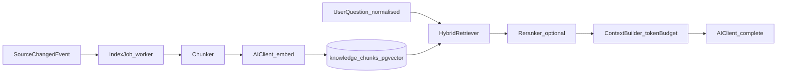

# 08 — RAG Architecture

> Apply `docs/GLOBAL_RULES.md` (esp. R-AI-02, R-AI-04, R-TEN-04).

## 1. Role of RAG in this product
RAG is **not** the first answer path. Order stays: Guard → Rules → DB (structured product facts) → FAQ → Cache → **(RAG-assisted) LLM**. RAG supplies the LLM with tenant-approved knowledge: product rich columns, FAQs, approved learned knowledge (from the learning queue), policies (delivery/return).

## 2. Knowledge sources (all tenant-scoped)
| Source | Origin | Update trigger |
|---|---|---|
| Products (features, specs, delivery_info, return_policy) | catalogue module | `catalogue.product.*` events |
| FAQs | faq module | `faq.entry.*` events |
| Approved knowledge items | learning module (staff reply → redact → approve) | `learning.knowledge.published` / `rolled_back` |
| Business policies | settings/templates (delivery, returns, payment) | `settings.changed` |

## 3. Pipeline


## 4. Indexing
- **Chunking:** structured sources become field-aware chunks (one product → summary chunk + per-section chunks); FAQ = one chunk; knowledge items ≤ ~300 tokens with overlap.
- **Metadata:** `tenant_id`, `source_type`, `source_id`, `source_version`, `locale`, `is_active`, `valid_from/to`.
- **Embeddings:** multilingual model (e.g. `bge-m3` / `multilingual-e5` local, or provider) chosen by settings `ai.embeddings.model`; model + dimension stored per chunk to allow re-index.
- **Versioning:** each publish creates new chunks with new `source_version`; rollback flips `is_active` — instant, no re-embedding.

## 5. Retrieval
- **Hybrid:** pgvector cosine (HNSW) + PostgreSQL FTS/trigram on normalised Bangla/Banglish text, fused with Reciprocal Rank Fusion.
- **Mandatory filters:** `tenant_id = :tenant AND is_active` (+ locale preference).
- **Top-k / threshold / token budget** from settings (`rag.top_k`, `rag.min_score`, `rag.max_context_tokens`).
- **Reranker hook** (`Reranker` port; cross-encoder optional later).
- **Grounding:** context builder attaches source ids so the Safety Validator can verify facts and so answers can be traced (`answer_traces.sources`).

## 6. Interfaces
```python
class Retriever(Protocol):
    async def retrieve(self, query: RetrievalQuery, ctx: AICallContext) -> list[RetrievedChunk]: ...
class Indexer(Protocol):
    async def upsert(self, docs: Sequence[KnowledgeDocument], ctx: AICallContext) -> None: ...
    async def deactivate(self, source_type: str, source_id: UUID, ctx: AICallContext) -> None: ...
```
Vector store behind `VectorStore` port (pgvector now; Qdrant/Weaviate possible later without business changes).

## 7. Cost controls
Embeddings cached by content hash; re-embed only changed chunks; small context (`rag.max_context_tokens`); RAG skipped entirely when deterministic path answers.

## 8. Evaluation
Retrieval golden sets (question → expected source ids) per locale; metrics: recall@k, MRR; answer groundedness in eval harness.

## 9. Phase mapping
Foundation (retriever/indexer ports, pgvector) in Phase 07; indexing of products/FAQ in Phase 12; learned knowledge + rollback in Phase 16.
