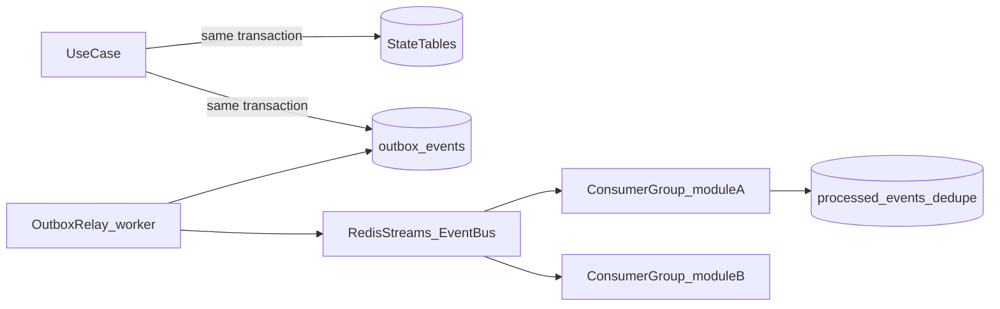

# 09 — Event-Driven Architecture

> Apply `docs/GLOBAL_RULES.md` (esp. R-EVT-*, R-DB-08).

## 1. Purpose
Decouple modules, enable async processing, feed read models/analytics, invalidate caches, and prepare for microservice extraction.

## 2. Mechanism

- **Transactional outbox** guarantees at-least-once publishing without dual-write bugs.
- **Relay worker** polls `outbox_events` (`FOR UPDATE SKIP LOCKED`), publishes to Redis Streams (`stream per topic group`), marks published.
- **Consumers** in consumer groups per module; idempotent via `processed_events(consumer, event_id)`.
- **In-process dispatch** option for synchronous domain events inside a module (not across modules).
- Port: `EventBus` (publish/subscribe) — swap to NATS JetStream / Kafka on extraction.

## 3. Event envelope
```json
{
  "event_id": "uuidv7", "type": "catalogue.product.updated", "version": 1,
  "occurred_at": "2026-10-13T12:00:00Z", "tenant_id": "uuid", "trace_id": "…",
  "actor": {"type": "user|system|customer", "id": "…"},
  "payload": { }
}
```
Schemas versioned in `backend/src/app/modules/<module>/domain/events.py` (Pydantic) and documented in an event catalogue.

## 4. Event catalogue (initial)
| Event | Producer | Consumers |
|---|---|---|
| `tenancy.tenant.created` | tenancy | settings (defaults), billing (draft subscription), onboarding |
| `billing.subscription.status_changed` | billing | notifications, tenancy (feature gate), analytics |
| `billing.payment.verified` | billing | billing (activate), notifications, audit |
| `catalogue.product.created/updated/deleted` | catalogue | answering (cache invalidate), rag indexer, analytics |
| `catalogue.import.completed` | catalogue | notifications, rag indexer |
| `faq.entry.changed` | faq | answering cache, rag indexer |
| `settings.changed` | settings | resolver cache invalidation, answering cache (rules/persona) |
| `channels.message.received` | channels | conversations (store + pipeline start) |
| `conversations.message.stored` | conversations | inbound pipeline, realtime, analytics |
| `conversations.voice.received` | conversations | stt job |
| `conversations.voice.transcribed` | conversations | inbound pipeline |
| `guard.message.rejected` | guard_rules | usage (spam_block), analytics |
| `conversations.status_changed` | conversations | realtime, notifications, analytics |
| `conversations.handoff.requested` | conversations | notifications, realtime |
| `answering.reply.generated` | answering | channels (send), usage, analytics |
| `ai.usage.recorded` | ai_platform | usage (ledger, quota) |
| `usage.quota.threshold_reached` (80/100%) | usage | notifications, billing (top-up offer) |
| `orders.order.created/confirmed/status_changed` | orders | notifications, analytics |
| `learning.knowledge.published/rolled_back` | learning | rag indexer, answering cache |
| `channels.connection.token_expiring` | channels | notifications |

## 5. Ordering & consistency
- Per-conversation ordering: stream partition key = `conversation_id` (consumer processes sequentially per key using a Redis lock / single-flight).
- Eventual consistency between modules; UI reflects via realtime events.
- Sagas (process managers) for multi-step flows: subscription activation (review ✔ + payment ✔ → active), order confirmation.

## 6. Failure handling
Retries with exponential backoff; after N attempts → dead-letter stream + `job_failures`; admin console shows DLQ with replay. Poison events never block a stream.

## 7. Webhooks as events
External webhooks (Meta, payments) are persisted (`webhook_events`, dedupe by provider id), ACKed fast (<1 s), then processed asynchronously via events/jobs.
