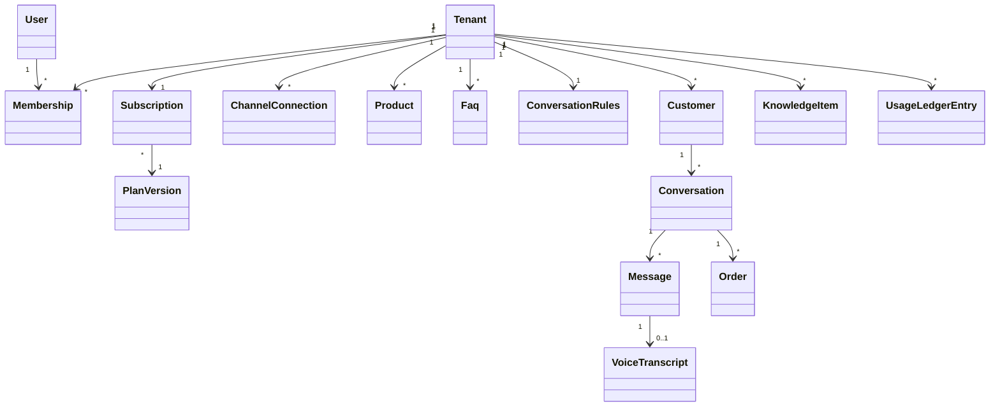
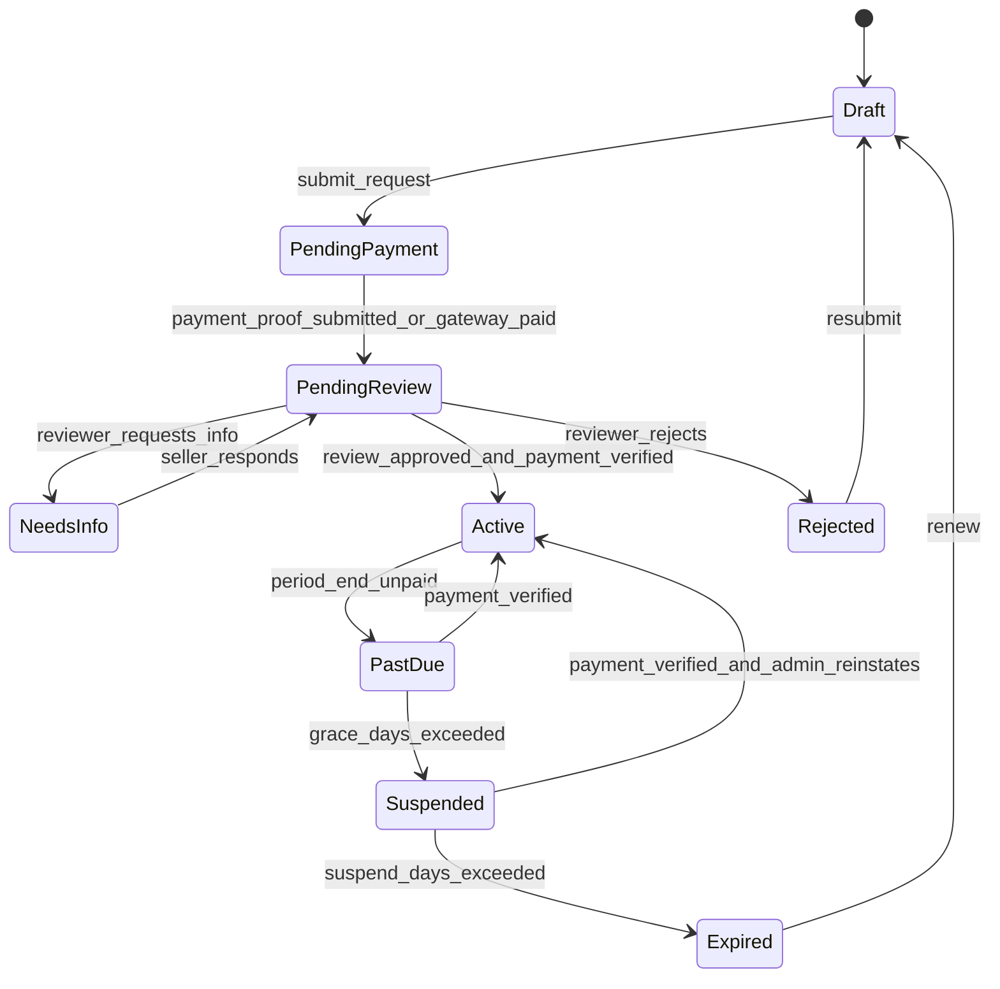
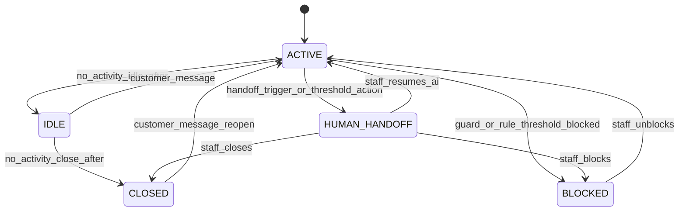
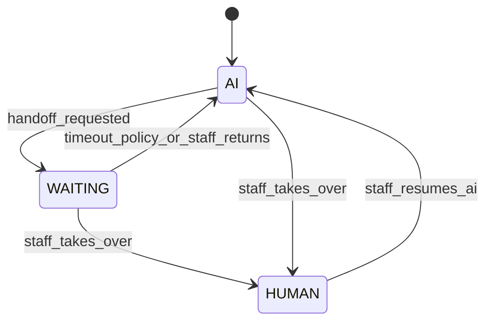
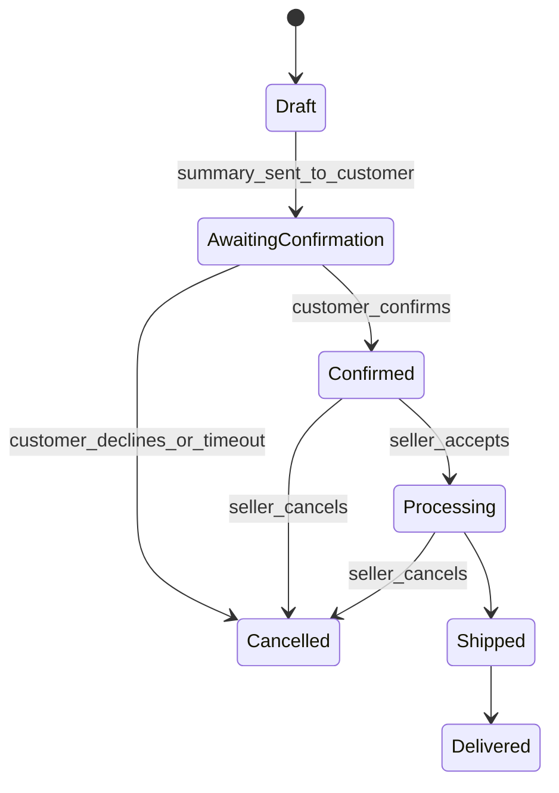

# 20 — Domain Model & State Machines

> Apply `docs/GLOBAL_RULES.md`. Every transition writes a `*_status_history` row and emits an event (R-DB-06). All timers/thresholds come from settings (R-CFG-01).

## 1. Core aggregates

## 2. Subscription (PDF §3–6)

Live AI features require `Active`. Public discovery never requires a subscription.

## 3. Conversation lifecycle (PDF §22)

Conversation attributes: `responder` (AI | HUMAN | WAITING), `ai_paused`, `urgency_score`, `spam_score`, `consecutive_irrelevant_count`, `assigned_user_id`, `last_activity_at`, `version`.

## 4. Responder / handoff (no AI + human double reply)

Invariant: an outbound auto-reply is sent only if `responder == AI` **at send time** (checked with row version / lock); a human reply while `responder == AI` forces `HUMAN` first.

## 5. Inbound message decision (PDF §26, §27.2)
| Condition | Outcome | LLM? |
|---|---|---|
| Conversation BLOCKED/CLOSED-by-policy | store only | no |
| Guard: rate limit / spam_score ≥ threshold | store, count spam_block (not quota), maybe BLOCKED | no |
| Voice STT failed / empty / low confidence | soft "please type" template or human alert | no |
| Forbidden keyword | apply threshold logic, log reason | no |
| Not in allowed topics, count < threshold | one soft redirect (template), increment counter | no |
| Count ≥ threshold | seller action: Pause AI / Handoff / BLOCKED | no |
| Relevant + deterministic hit (DB/FAQ/Cache) | reply | no |
| Relevant + miss + quota/budget OK | LLM short context → safety → reply | yes |
| Relevant + miss + quota exhausted | soft handoff template (never fake) | no |
Message is **always stored**; only the auto-reply changes. Relevant message resets `consecutive_irrelevant_count`.

## 6. Order (PDF §8, §11)

Price per item ≥ `min_price` enforced in domain; order total recomputed from DB, never from LLM text.

## 7. Learning item (PDF §10)
`Candidate (from staff reply) → Redacted → PendingApproval → Approved/Published (versioned) → RolledBack`; Rejected terminal. Only Published versions are retrievable; tenant-scoped only.

## 8. CSV import batch (PDF §25)
`Uploaded → Validating → DryRunReady (create/update/skip/error counts) → Confirmed → Applying → Completed | Failed | Cancelled`. Duplicate key: `sku` within tenant, else `lower(name) + variant`.

## 9. Channel connection
`Pending → Connected → TokenExpiring → Expired | Disconnected | Error`.
