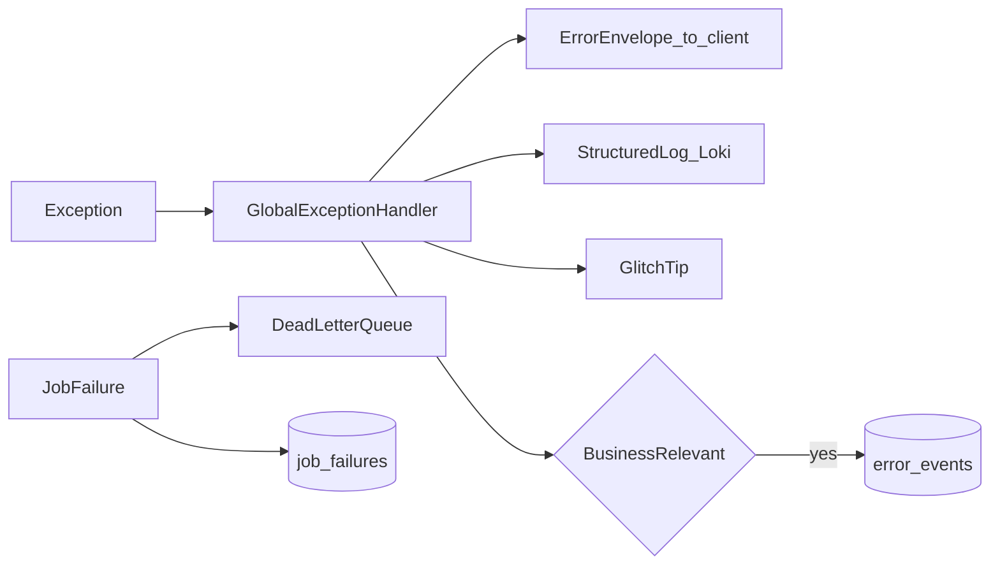

# 22 — Error Logging & History

> Apply `docs/GLOBAL_RULES.md` (esp. R-OBS-*, R-DB-06, R-DB-07). Implemented in Phases 01, 02, 05, 18 and used by every phase.

## 1. Error logging

### 1.1 Flow

### 1.2 Typed error catalogue
Base `AppError(code, http_status, message_key, details, retryable)`. Codes are stable strings `module.area.reason`; mapped to i18n keys in `frontend/packages/i18n`. Unknown exceptions → `internal.unexpected` (500) with trace_id only.

### 1.3 `error_events` (business-relevant failures)
| Column | Notes |
|---|---|
| id, tenant_id (nullable), module, code, severity | |
| source_type / source_id | webhook_event, message, csv_row, payment, job, ai_request |
| message (redacted), context jsonb (redacted), payload_ref (object key) | no raw PII |
| trace_id, occurred_at | |
| retry_count, next_retry_at, resolved_at, resolved_by, resolution_note | |
Examples: Meta webhook signature failure, outbound send failure, STT failure, LLM provider error, payment verification error, CSV row error, token expired.

### 1.4 Jobs
`job_failures` (job name, queue, payload ref, attempts, last error code, trace_id) + DLQ stream; admin console: list, inspect, retry, discard (audited).

### 1.5 Frontend
Route-group error boundaries; API error → toast/i18n by `code`; unexpected errors → GlitchTip with `trace_id`, user id (hashed), tenant id.

### 1.6 Redaction & retention
Redaction processor in structlog (emails, phones, tokens, card-like numbers, Bangladesh phone formats); retention: logs 30 days (configurable), error_events 180 days, job_failures 90 days.

## 2. History & audit trail

| Table | Purpose |
|---|---|
| `audit_log` (append-only, partitioned) | actor_type/id, impersonator_id, tenant_id, action, entity_type, entity_id, before jsonb, after jsonb (redacted), ip, user_agent, trace_id, occurred_at |
| `subscription_status_history` | from, to, reason, actor, at |
| `conversation_status_history` | from, to, reason (guard/rule/staff/timer), actor |
| `handoff_events` | requested/taken/resumed/timeout with actor |
| `order_status_history` | from, to, actor |
| `product_versions`, `csv_import_batches`, `csv_import_rows` | catalogue history + import results |
| `conversation_rules_history` | rules versions (rollback) |
| `setting_values_history`, `message_templates_history` | settings/template versions (rollback) |
| `ai.prompt_versions` | prompt history (rollback) |
| `knowledge_versions` | learned knowledge (rollback) |
| `ai.ai_requests` | every AI call: provider, model, prompt version, tokens, cost, latency, cache hit |
| `guard_decisions`, `answer_traces` | why a message was ignored/answered and from which source |
| `messages`, `voice_transcripts` | full conversation history (separate from LLM short memory) |

Rule: **every write use case writes an audit entry** through `AuditPort` (same transaction or outbox).

## 3. Project / implementation history
| File | Content |
|---|---|
| `docs/PROGRESS_LOG.md` | one entry per completed phase: date, phase, outcome, deviations, follow-ups |
| `docs/CHANGELOG.md` | Keep-a-Changelog format: Added/Changed/Fixed/Removed per version |
| `docs/adr/NNNN-*.md` | architecture decisions (context, decision, consequences, status) |

## 4. Admin visibility
Admin console pages: Audit log (filter by tenant/actor/entity), Error events (filter by code/module, resolve), Jobs/DLQ (retry), AI requests (cost explorer).
