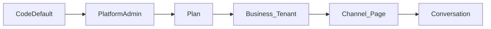

# 24 — Configuration Management (everything configurable, nothing hardcoded)

> Apply `docs/GLOBAL_RULES.md` (esp. R-CFG-*).

## 1. Two kinds of configuration
| Kind | Where | Who changes |
|---|---|---|
| Infrastructure config (DB URL, Redis URL, master key, SMTP host) | env vars → typed `AppConfig` (pydantic-settings), fail-fast | DevOps |
| Business configuration (thresholds, texts, prices, models, timers, features) | `settings` module (DB) via registry + resolver; templates; entitlements; prompt registry | Platform admin / Business owner & manager / User |

## 2. Layered resolution

User chain (separate): `CodeDefault → Platform → User`. The two chains never mix.

- Most specific layer wins **within bounds** set by upper layers (platform/plan min/max/allowed values).
- Result cached in Redis (`t:{tenant}:settings:v{n}`), invalidated by `settings.changed`.

## 3. Setting definition (registry)
Declared in each module's `settings.py`:
```python
SettingDefinition(
    key="voice.max_duration_seconds",
    chain="tenant",                       # "tenant" | "user"
    type=int, schema={"minimum": 5, "maximum": 300},
    default=60,
    overridable_at=["platform", "plan", "tenant"],
    bounded_by=["platform", "plan"],      # clamp tenant value to these
    edit_permission="settings.business:write",
    entitlement="voice.enabled",
    is_secret=False,
    ui={"group": "voice", "widget": "slider", "label_key": "settings.voice.max_duration"},
)
```
Definitions are synced to `setting_definitions` at startup; `GET /api/v1/settings/schema?chain=tenant|user` returns them (filtered by caller permission + entitlement) for schema-driven UIs.

## 4. Storage
- `setting_values(scope_type, scope_id, key, value jsonb, version, updated_by, updated_at)` + `setting_values_history` (rollback).
- `message_templates(key, locale, scope_type, scope_id, body, variables_schema, version, is_active)` + history. Rendering: sandboxed, variables validated.
- `secrets(scope_type, scope_id, key, ciphertext, key_version, created_by)` — never returned in API (only "set/not set" + last4).
- Every change → audit entry + `settings.changed` event.

## 5. Business vs user scope & roles
- **Business settings (`tenant` chain):** one value for the whole business.
  - Owner: everything (billing, plan, team, BYO key, channels, data export/deletion).
  - Manager: operational settings (persona, rules, FAQ, templates, catalogue, orders, urgency, canned replies) — not billing/team ownership/secrets.
  - Agent: read-only.
- **User settings (`user` chain):** personal, never affect others; every user (incl. owner) has them.
- An owner's personal preference ("email me on every order") is a **user** setting.
- Registry marks every key with its chain; saving at the wrong scope is rejected.

## 6. Inventory — Platform Admin (admin console)
| Group | Keys (examples) |
|---|---|
| Plans | `plans.*` price, period, trial_days, quotas (ai_conversations, stt_seconds), entitlements, overage price, top-up packs |
| Subscription rules | `billing.grace_days`, `billing.suspend_after_days`, `billing.expire_after_days`, `billing.review_required_docs` |
| Payments | manual methods (bKash/Nagad/bank accounts), gateway secrets, `billing.invoice_template`, `billing.vat_percent` |
| AI providers | `ai.providers.enabled`, provider secrets, `ai.routing.<feature>`, `ai.model_prices`, `ai.global_budget_daily`, `ai.kill_switch` |
| Prompts | prompt registry (versions, promote/rollback, eval gate) |
| STT defaults/bounds | `voice.max_duration_seconds` (bounds), `voice.min_confidence`, `voice.allowed_formats`, `voice.max_file_mb` |
| Guard defaults/bounds | `guard.rate_limit_per_minute`, `guard.spam_score_threshold`, `guard.spam_weights` |
| Lifecycle defaults/bounds | `lifecycle.idle_after_minutes`, `lifecycle.close_after_hours` |
| Retention | `retention.audio_days`, `retention.transcript_days`, `retention.messages_days`, `retention.logs_days`, `retention.exports_days` |
| Content | feature matrix, pricing text, legal page versions, email/notification templates, public FAQ |
| Operations | admin users/roles, Meta app config (secrets), feature flags + rollout %, `platform.maintenance_mode`, announcement banner, `app.min_supported_version` |

## 7. Inventory — Business (seller panel; bounded by plan & platform)
| Group | Keys (examples) | Edit role |
|---|---|---|
| Profile | `business.name`, logo, contact, `business.timezone`, `business.currency`, `business.default_locale` | Owner/Manager |
| Team | members, roles, `team.working_hours`, availability rules | Owner |
| Channels | connect/disconnect pages, `channels.ai_enabled` per page, per-page overrides | Owner |
| Persona | `agent.bot_name`, `agent.tone`, `agent.reply_language` (bn/en/banglish/auto), `agent.greeting`, `agent.sign_off`, `agent.emoji_level`, `agent.max_reply_chars` | Owner/Manager |
| AI behaviour | `agent.mode` (auto/suggest/off), `agent.off_hours_behaviour`, `agent.handoff_keywords`, `agent.handoff_order_value`, `agent.deterministic_only`, `ai.use_byo_key`, `ai.tenant_budget_daily`, `ai.model_tier` | Owner/Manager (BYO/budget: Owner) |
| Conversation Rules | `rules.allowed_keywords`, `rules.forbidden_keywords`, `rules.redirect_message` (template), `rules.irrelevant_threshold`, `rules.threshold_action` | Owner/Manager |
| Guard | `guard.rate_limit_per_minute`, `guard.spam_score_threshold` (within bounds), block list | Owner/Manager |
| Lifecycle & urgency | `lifecycle.idle_after_minutes`, `lifecycle.close_after_hours`, `lifecycle.reopen_policy`, `urgency.weights` (wait time, order intent, VIP, handoff requested) | Owner/Manager |
| Voice | `voice.enabled`, `voice.max_duration_seconds`, `voice.min_confidence`, `voice.low_confidence_action`, `voice.please_type_message` (template), `voice.show_transcript` | Owner/Manager |
| Catalogue | categories, custom fields, CSV mapping templates, `catalogue.duplicate_rule`, `catalogue.show_stock`, `catalogue.price_display`, per-product `min_price`, `catalogue.discount_allowed_max_percent` | Owner/Manager |
| Replies | FAQ entries, canned replies, all customer-facing templates (redirect, please-type, handoff, out-of-window, quota-exhausted, order summary/confirmation) | Owner/Manager |
| Orders | `orders.required_fields`, `orders.delivery_charges` (inside/outside Dhaka, by area), `orders.payment_options` (COD, bKash…), `orders.confirmation_timeout_minutes`, custom statuses | Owner/Manager |
| Quota & notifications | `usage.warn_threshold_percent` (default 80), `usage.on_exhausted` (pause/soft_handoff/auto_topup/overage), `usage.exhausted_message` (template), business notification routing | Owner |
| Learning | `learning.auto_suggest`, `learning.approvers`, `learning.redaction_rules` | Owner/Manager |
| Data | `retention.*` (within bounds), data export, deletion request | Owner |

## 8. Inventory — User (every user incl. owner)
`user.locale`, `user.theme`, `user.timezone_display`, `user.notifications.<event>.<channel>` (in-app/email/push), `user.availability_status`, `user.sound_alerts`, `user.inbox_default_view`, `user.inbox_filters`, `user.reply_signature`.

## 9. Per conversation (staff action, stored on conversation)
AI pause/resume, assign staff, block/unblock, take-over, close/reopen.

## 10. End customer (buyer)
Detected + remembered locale, opt-out ("stop" keyword configurable), data deletion request (Meta callback).

## 11. Phase mapping
P01 registry + resolver + template renderer · P02 tables · P05 admin settings UI + plan config · each feature phase registers its keys/templates + seller UI · P15 unified Seller Settings Centre · P03 user settings basics.
